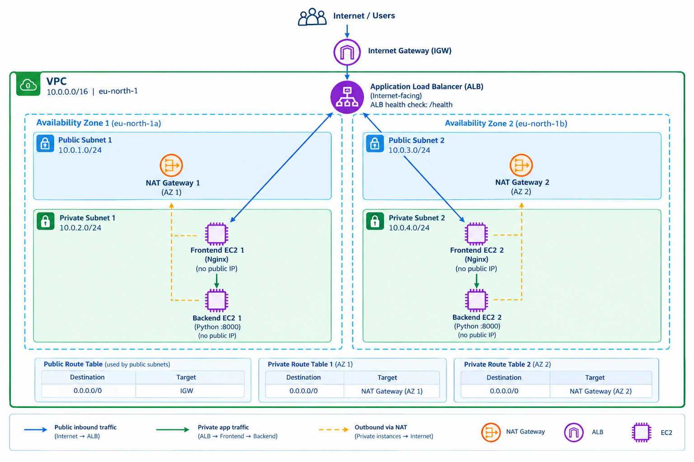

# AWS VPC Networking with Terraform

A Terraform lab that provisions a highly available, two-tier application network in AWS. The design spans two Availability Zones and places the public entry point in public subnets while keeping application instances in private subnets.

## Architecture

The following diagram illustrates the AWS infrastructure deployed by this project.




> The diagram describes the intended routing and placement. Confirm the current Terraform state and AWS resources before assuming the stack is deployed. NAT gateways provide outbound connectivity from private subnets; they do not permit unsolicited inbound internet traffic to private instances.

## Resources

- **VPC:** `10.0.0.0/16`, with DNS support and DNS hostnames enabled.
- **Public subnets:** `10.0.1.0/24` and `10.0.3.0/24`, in separate Availability Zones.
- **Private subnets:** `10.0.2.0/24` and `10.0.4.0/24`, in separate Availability Zones.
- **Internet Gateway:** provides internet routing for the public subnets.
- **NAT Gateways:** one in each public subnet, each with an Elastic IP; private route tables use their corresponding NAT Gateway for outbound internet access.
- **Application Load Balancer:** internet-facing, HTTP listener on port `80`, deployed across both public subnets.
- **Frontend tier:** two Ubuntu Server 24.04 LTS EC2 instances running Nginx in private subnets. Nginx proxies requests to both backend instances.
- **Backend tier:** two Ubuntu Server 24.04 LTS EC2 instances running a small Python HTTP service on port `8000`.
- **Security groups:** ALB accepts HTTP from the internet; frontend accepts HTTP only from the ALB security group; backend accepts port `8000` from the frontend security group.
- **Terraform state:** an S3 bucket is configured for remote state. Protect the bucket and state file from accidental deletion.

## Request flow

1. A browser sends an HTTP request to the ALB DNS name.
2. The ALB listener forwards the request to a healthy frontend target on port `80`.
3. Nginx on that frontend proxies the request to one of the backend servers on port `8000`.
4. The backend returns a response through the frontend and ALB to the browser.
5. The ALB checks frontend health using `GET /health` and expects HTTP `200`.

## Prerequisites

- AWS account with permission to create VPC, subnet, route table, internet gateway, NAT gateway, Elastic IP, security group, EC2, and ELBv2 resources.
- AWS CLI configured with credentials for the intended account.
- Terraform installed.
- The AWS region configured for this lab, currently `eu-north-1` (Europe/Stockholm).

## Configuration

Review `variables.tf` and `terraform.tfvars` before planning. The current configuration defines the project name, VPC tag, and EC2 instance type. The AMI data source selects the latest matching Ubuntu Server 24.04 LTS x86_64 image published by Canonical.

## Commands

Format and validate the configuration:

```bash
terraform fmt -recursive
terraform validate
```

Preview changes before making them:

```bash
terraform plan
```

Apply only when you intentionally want to create or update billable AWS resources:

```bash
terraform apply
```

Inspect the public ALB DNS name after it has been created:

```bash
terraform output -raw frontend_alb_dns_name
```

Open the returned DNS name in a browser with `http://` at the beginning.

To inspect the registered frontend targets:

```bash
aws elbv2 describe-target-health \
  --region eu-north-1 \
  --target-group-arn "$(terraform output -raw frontend_target_group_arn)"
```

The target-group command requires an output named `frontend_target_group_arn`; add that output to Terraform if you want to use this exact command.

## Important notes

- **Cost:** NAT Gateways, Elastic IPs, EC2 instances, and the ALB can incur charges while provisioned. Destroy lab resources when finished, after reviewing the plan carefully.
- **State safety:** if S3 is used as the Terraform backend, do not delete the bucket or its state object until you have a verified backup and have deliberately migrated away from the remote backend. The state tracks resource ownership and is needed for safe Terraform operations.
- **Destroy protection:** `lifecycle.prevent_destroy` on the state bucket intentionally blocks a destroy plan that would delete the bucket. Do not remove that protection casually.
- **Availability:** two frontend and two backend instances across two Availability Zones improve resilience, but this is a learning lab rather than a complete production deployment. Production readiness would require, among other things, HTTPS, monitoring/alerts, a real application, stronger access management, and tested recovery procedures.
- **Outbound access:** private instances use NAT for package installation. Security group egress must permit the required outbound connections. Prefer the narrowest egress rules that meet the application requirements.
- **Health checks:** the frontend `/health` endpoint returns `200` from Nginx; this verifies Nginx is responding, not that the backend application is healthy.

## Repository layout

Typical files in this lab:

- `vpc.tf` — VPC, subnets, internet gateway, and public routes.
- `nat.tf` — Elastic IPs, NAT Gateways, and private route tables.
- `security_groups.tf` — ALB, frontend, and backend security groups.
- `security_group_rules.tf` — additional security-group rules.
- `instances.tf` — Ubuntu EC2 instances and user-data bootstrap scripts.
- `alb.tf` — ALB, target group, attachments, listener, and ALB DNS output.
- `variables.tf` / `terraform.tfvars` — input variables and values.
- `outputs.tf` — resource identifiers and useful outputs.
- `s3_bucket.tf` — S3 bucket used for Terraform state.

Resource names may vary if the configuration has been changed; keep this documentation in sync with the actual Terraform files.
